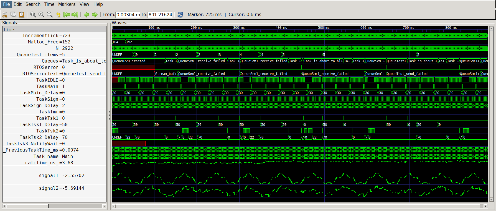
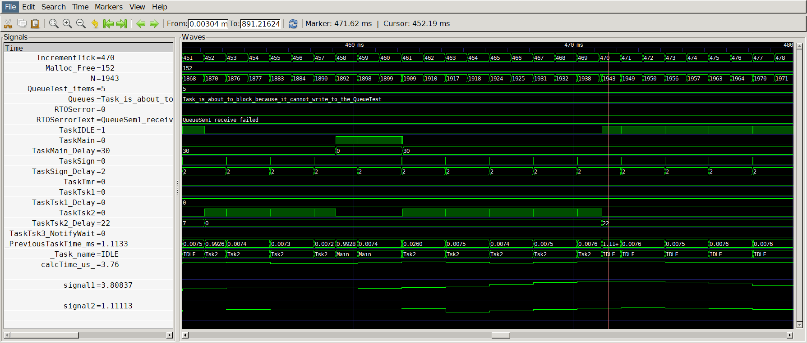
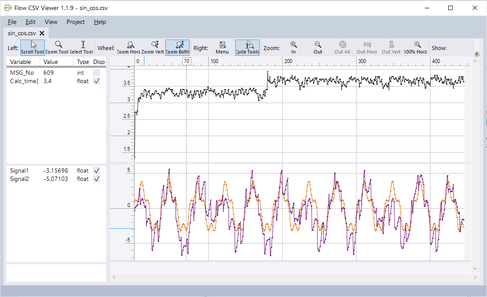

# RTEdbg Data Export and Visualization Options

The **[RTEdbg](https://github.com/RTEdbg/RTEdbg)** library records data in compact binary form in a circular memory buffer. This approach minimizes the processing, code-memory, and RAM overhead associated with logging on an embedded target.

After the recorded data is transferred to a host computer, the **[RTEmsg](https://github.com/RTEdbg/RTEmsg)** application decodes it using configurable, `fprintf()`-style format definitions. The decoded information can be written to text logs, CSV files, VCD files, and other text-based formats, making it suitable for log viewers, spreadsheet applications, graphing tools, and automated test processing. The output format strings and definitions are maintained on the host, rather than stored as formatted text in the target firmware.

The same recorded message can be included in multiple output files and formatted differently for different purposes. For example, an event may appear in a human-readable log while its timing information is also exported for graphical analysis. This makes it easier to isolate information of interest without searching through a large, combined log.

## Visualizing Execution and Timing with VCD

RTEmsg can export selected logged information in **Value Change Dump (VCD)** format. VCD files can be opened in waveform viewers such as [GTKWave](https://gtkwave.github.io/), enabling developers to inspect task execution, event sequences, signal changes, and timing relationships graphically.

The required output is defined through host-side formatting, so the embedded firmware does not need to construct VCD file contents. Visual inspection of waveforms can reveal execution patterns and timing problems that are difficult to identify from text logs alone.

> The following images show a full trace and a zoomed-in view from the [FreeRTOS trace demo project](https://github.com/RTEdbg/FreeRTOS-trace-demo). The formatting definitions can be found in the [RTEdbg/Fmt](https://github.com/RTEdbg/FreeRTOS-trace-demo/tree/master/RTEdbg/Fmt) folder, and the trace demo code is available in [TestTrace.c](https://github.com/RTEdbg/FreeRTOS-trace-demo/blob/master/TestRTOS/TestTrace.c).

**Full trace:**



**Zoomed-in trace:**



## Exporting Data to CSV

> The recorded dataset can also be decoded into CSV files for numerical analysis, graphing, or processing in spreadsheet software. The following example uses data from the FreeRTOS trace demo.



## Separating Output by Purpose

RTEmsg can write selected information to multiple output files. This allows, for example, general logging, RTOS execution-time analysis, and error reporting to be handled independently. Such output can also serve as input to automated tests and report-generation scripts.

The following examples illustrate several possible output files.

### Main Log

By default, decoded messages are written to the main log file (`Main.log`), unless the output configuration specifies otherwise.

```text
N00108  389.847 MSG0_START_SIN_COS: Sin_cos_demo() function started
N00109  389.856 MSG2_SINCOS_DEMO: -0.764321, -1.8584, 9.34375 us
N00110  389.858 MSGN3_BATT_DEMO: Hex: 000004F4 014D0000 001E9499
  Battery voltage = 12.68 V, current = 0.00,
  Charged Ah = 0.0, discharged Ah = 33.3,
  Temperatures: 26.5, 24.0, SOC: 3.0
N00111  390.846 MSG0_SIMPLE_TEST_START: simple_demo() function started
N00112  390.847 MSG1_UWTICK: Tick 391
N00113  390.847 MSG0_START_SIN_COS: Sin_cos_demo() function started
N00114  390.857 MSG2_SINCOS_DEMO: -0.722788, -1.76581, 9.46875 us
N00115  391.846 MSG1_LONG_TIMESTAMP: 0x5
```

### RTOS Task Execution Times

The following example lists individual task execution intervals derived from the decoded FreeRTOS trace. It can be used to examine task run times and execution patterns.

```text
MSG #  Time[ms] Task name Run time [ms]
---------------------------------------
N00562  130.179 TaskMain  0.9998
N00566  130.187 TaskSign  0.0071
N00569  132.180 TaskMain  1.9930
N00573  132.187 TaskSign  0.0071
N00578  132.213 TaskMain  0.0267
N00583  132.222 TaskTsk3  0.0091
N00586  134.180 TaskIDLE  1.9572
N00590  134.187 TaskSign  0.0073
N00593  136.180 TaskIDLE  1.9927
N00597  136.187 TaskSign  0.0072
N00600  138.180 TaskIDLE  1.9928
N00604  138.187 TaskSign  0.0072
```

### Errors and Warnings

Errors, warnings, and other diagnostic messages can be directed to a separate file, avoiding the need to search for them in a long main log. This excerpt is from the FreeRTOS demo's `RTOS_errors.log` file. The demo intentionally exercises some failure conditions to illustrate how they are reported.

```text
N00453  101.181 Stream buffer 0x20001AC0 receive failed
N00669  155.184 QueueReceive from QueueSem1 failed, ticks to wait 0
N02609  645.184 QueueSend to QueueTest failed
N03272  817.184 QueueReceive from QueueSem1 failed, ticks to wait 0
N03465  867.184 QueueSend to QueueTest failed
```

### Cortex-M4/M7 Exception Report

RTEdbg can also record processor-register values after a fatal exception and format them into a readable diagnostic report on the host. The following example is taken from the [Cortex-M4/M7 fault-handler demo](https://github.com/RTEdbg/RTEdbgDemo/blob/master/STM32L433/RTEdbg/Demo_code/Simple_Cortex_M4-M7_fault_handler.md).

In this **specific bare-metal demo implementation**, only 32 bytes of additional handler code are used to prepare and log the register data, and execution of the RTEdbg logging function requires 20 bytes of stack space. These figures describe the demonstrated implementation, not a general memory requirement for every RTEdbg-based exception handler. The register data is logged in binary form; the detailed textual report is generated on the host. - see the formatting definition file [cortex_M7_fault.h](https://github.com/RTEdbg/RTEdbgDemo/blob/master/Simple_STM32H743/RTEdbg/Fmt/cortex_M7_fault.h). Although this format definition may appear complex at first glance, it only needs to be created once and can be reused across multiple projects. This example demonstrates how raw binary data (including bit fields) can be rendered in a user-friendly format.

```text
N05529 1203.292 MSGN_FATAL_EXCEPTION:
CPU registers
  R00:0x64171647, R01:0x200000AC, R02:0x07000000, R03:0x00000259
  R04:0x20000088, R05:0xFC000000, R06:0x2000008C, R07:0x200000A8
  R08:0x00EAC4E1, R09:0x080027B4, R10:0xFA481A48, R11:0x00000064
  R12:0x00000000,  SP:0x2001FF28,  LR:0x03000000,  PC:0x08000938
  xPSR:0x21000000, Flags: Q=0, V=0, C=1, Z=0, N=0
     Interrupted exception: #0 - Thread mode (vector table address: 0x00)
  ICSR: 0x00000803
     Active exception: #3 - HardFault (vector table address: 0x0C)
     Pending exception: #0 - Thread mode (vector table address: 0x00)     
  CFSR:0x00008200       
     Bus fault 
        A data bus error has occurred, and the PC value stacked for the exception return points to the instruction that caused the fault.    
        Valid fault address       
  Offending address:0x07000000
```

The example illustrates how compact binary logging can preserve diagnostic information without the overhead of formatting the full register dump in the embedded firmware. For RTOS-based applications, use an exception handler that correctly accounts for the stack pointer in use when the exception occurs; the linked example is designed for bare-metal systems.
